# Slipstream

Print your todos as designed slips on an **Epson TM-T20III** (80 mm thermal, USB).
One todo per slip, numbered from `#00000`, with a QR and a Code 128 on one rail so a future app can scan them to mark them done.

Slipstream is a menu bar app with a full dashboard. It talks ESC/POS straight to the printer over USB, so there is no Epson driver to install.

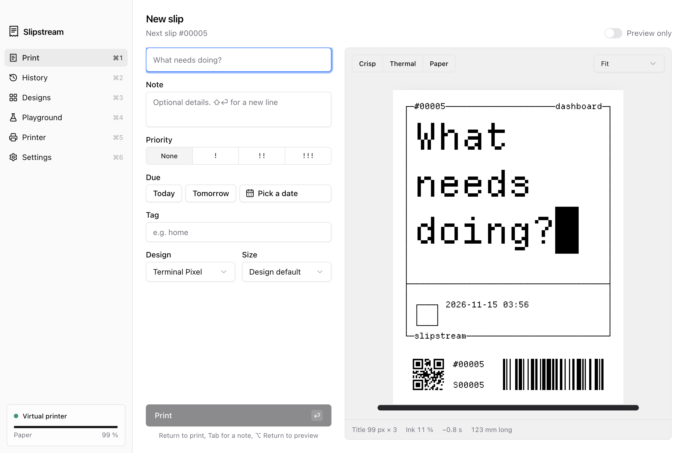

| Menu bar popover | History (dark) |
|---|---|
| 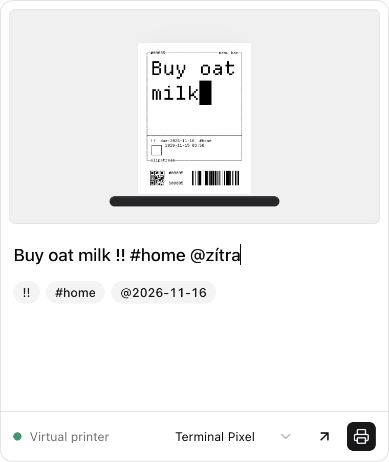 | 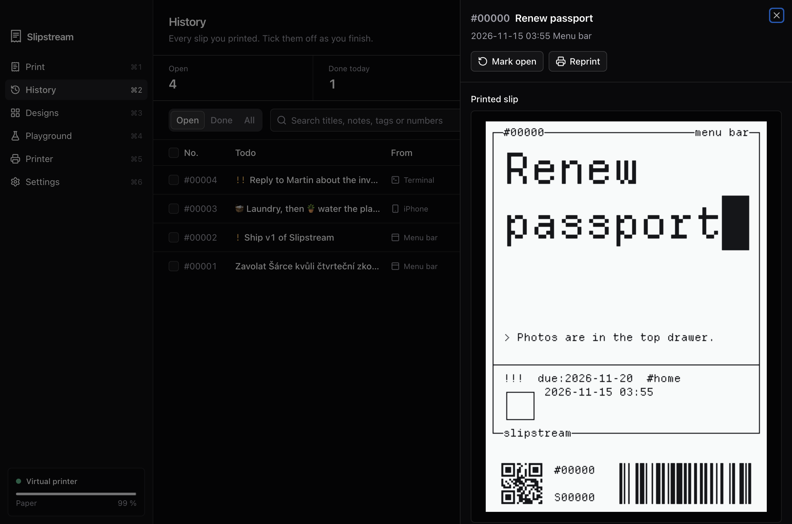 |

## Quick start

```bash
pnpm install
pnpm dev:mock        # run with the virtual printer (no hardware needed)
pnpm dev             # run against the USB printer
pnpm test            # unit + integration tests (codes, raster, ESC/POS, queue, API, quick syntax)
pnpm samples         # render all 14 designs × 6 sample slips into .context/samples/
pnpm samples:check   # same, exits 1 if any slip fails a print check (codes, quiet zones, fonts, ink)
pnpm dist:dir        # unsigned Slipstream.app in dist/mac-arm64
```

Data lives in `~/Library/Application Support/Slipstream` (`Slipstream Dev` when running from source):
- `slipstream.db`: the SQLite history and queue
- `rasters/`: the exact 1-bit bitmap of every print job
- `api.env`: the API tokens

## The 14 designs

Every design is rendered in true 1-bit. The samples, left to right: short, long, Czech pangram, emoji, all fields + reprint, due today.

**Terminal Pixel (default)**: A 40-column terminal session on the dot grid; the block cursor is the only solid black.

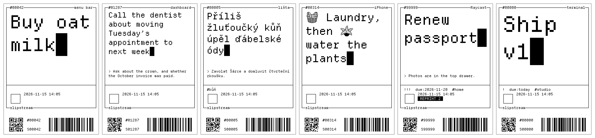

**Swiss Grid**: Flush left on 8 × 64-dot columns; the number with its leading zeros in a 50% tint.

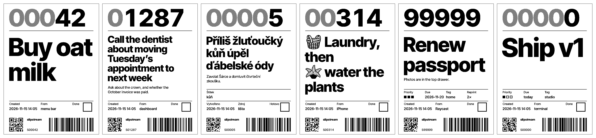

**Editorial**: Front page of a one-story newspaper, nameplate between thick and thin rules.

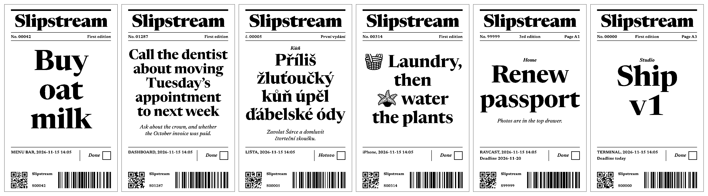

**Brutalist**: Edge-to-edge condensed caps under a black slab with the number knocked out.

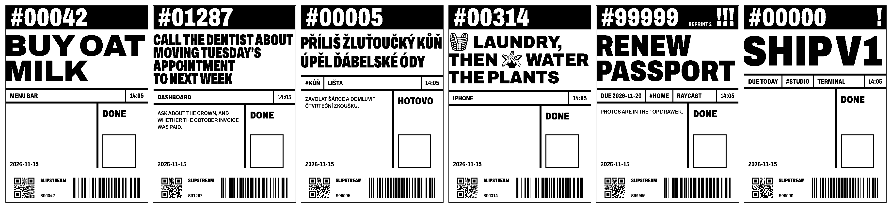

**Playbill**: Victorian wood-type bill: every line fitted to the full width, face chosen by size.

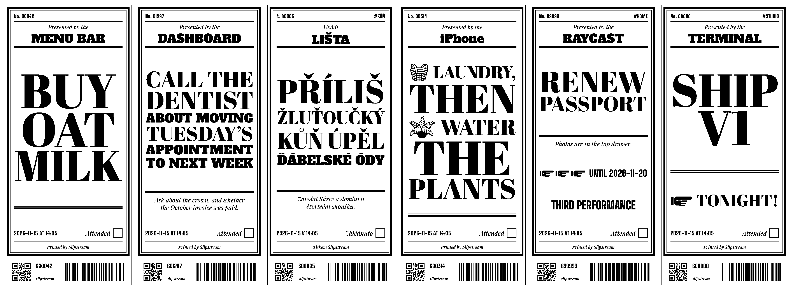

**Halftone**: Print-shop poster; the stippled long shadow is the dithering itself.

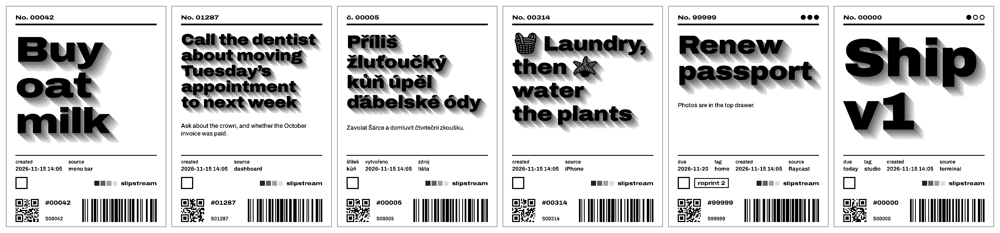

**Constructivist**: Czech 1920s avant-garde: a 28° bar XORs through the title.

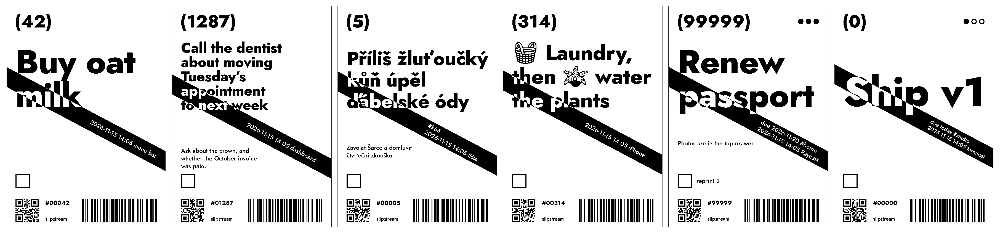

**Ticket Stub**: Admission ticket with a validator imprint; tear the stub when the todo is done.

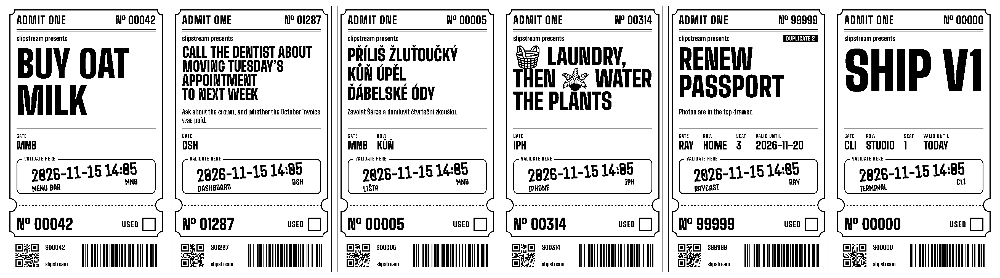

**Boarding Pass**: The todo is a flight: FROM source TO tag.

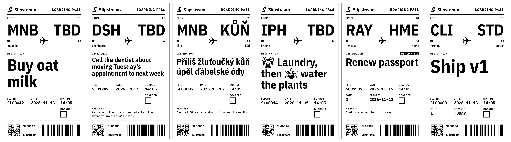

**Postage Stamp**: Perforated stamp; priority is the face value, with an ISO postmark.

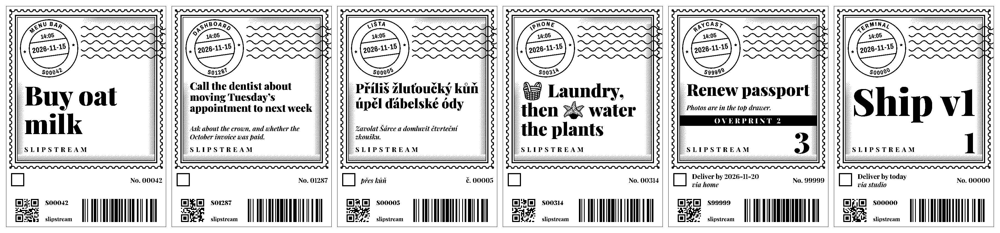

**Library Card**: Date-due card; every reprint stamps a new ledger row.

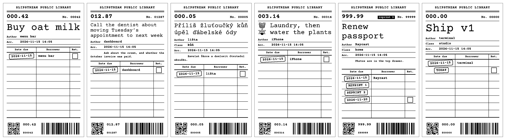

**Technical Drawing**: Engineering title block with live dimension lines measuring the title.

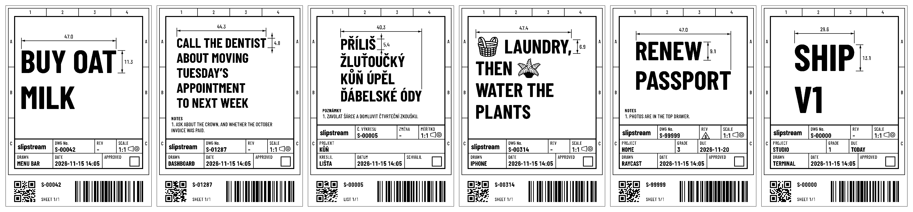

**Museum Label**: Gallery wall label with a single black audio-guide badge.

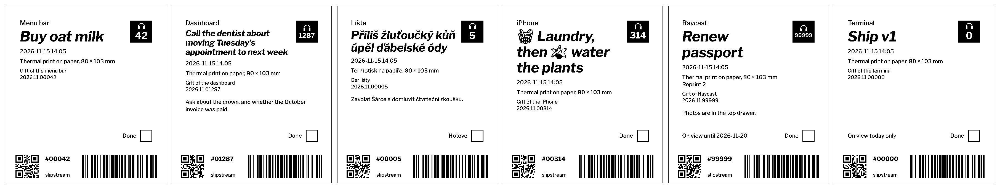

**Matchbox Label**: 1960s Czechoslovak matchbox label; the emblem is generated from the slip number.

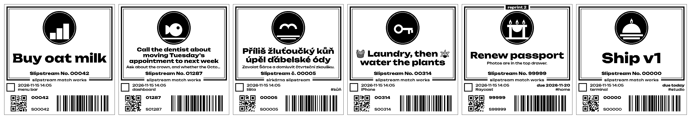

## Everyday use

- **Quick print**
  - Click the menu bar icon or press **⌃⌥Space**, type, press **Return**.
  - **Tab** adds a note, **⇧Return** is a new line, **↑** on an empty field offers to reprint the last slip, and **Esc** closes.
- **Quick syntax** (Czech and English): `Buy milk !! #home @today` sets priority 2, the tag `home` and due today.
  - Due words: `@dnes`, `@zítra`, `@pá`, `@fri`, `@20.11.`, `@2026-11-20`.
  - A tag must start with a letter (`#12` stays text). `\#tbt` escapes it.
- **Dashboard**
  - Print (live preview in Crisp, Thermal and Paper modes)
  - History (tick slips done, reprint, see the exact printed bitmap)
  - Designs, Playground (tune a design, export PNGs)
  - Printer (status, queue, paper meter, calibration)
  - Settings
- **Preview only:** nothing is printed or numbered. Use it to iterate on designs without paper.
- **Printer off or out of paper?** Slips wait in the queue and print in order when it is back. A slip counts as printed only after the printer confirms it.

### First-time printer setup

1. Plug in the TM-T20III, switch it on, and load standard 80 mm paper.
2. Printer → **Print test page**. Measure the blank strip above the top line (about 11.5 mm) and enter it. The bottom margin then matches, so every slip gets an even border.
3. Adjust **Darkness** if text looks thin. The TM-T20III has no per-job density control, so Slipstream moves the black/white threshold instead.

If macOS has added the printer under System Settings and a print job is holding it, Slipstream shows **busy** and retries.

## Command line, Raycast, iPhone

Install the `slip` command from Settings → Integrations; it symlinks `resources/cli/slip`. It only needs `curl`.

```bash
slip 'Buy milk !! #home @today'      # single quotes: zsh/bash treat !! and # specially
slip -p 2 -t home -d zítra 'Buy milk'
slip -n 'ask about the crown' 'Dentist'
slip --preview out.png 'Try a title' # exact thermal bitmap, prints nothing
slip ls [open|done|all]   slip done 42   slip reprint 42   slip status
```

Raycast: add `resources/raycast/slip.sh` as a script command.

**iPhone Shortcut:**
1. Turn on *Allow devices on my network* in Settings. It is off by default and uses its own token.
2. In Shortcuts, chain **Dictate Text** → **Get Contents of URL**: `POST http://<mac>:4748/v1/quick`, with header `Authorization: Bearer <network token>` and the dictated text as the body.

### REST API (`http://127.0.0.1:4747`, `Authorization: Bearer $SLIPSTREAM_TOKEN`)

| Method | Path | Notes |
|---|---|---|
| POST | `/v1/quick` | Raw quick-syntax text (plain text, form or JSON). `?format=text` returns a one-line reply; `?preview` returns a PNG |
| POST | `/v1/slips` | JSON `SlipInput`. Honours an `Idempotency-Key` header |
| GET | `/v1/slips?status=open\|done\|all` | `&format=text` gives one line per slip |
| GET | `/v1/slips/:ref` | `:ref` is a number, `S00042`, or `SLIPSTREAM://S/00042` |
| POST | `/v1/slips/:ref/done` · `/undone` · `/reprint` | |
| POST | `/v1/preview` | PNG of any design (`PreviewRequest`) |
| GET | `/v1/printer` | Live printer status, queue and paper meter |

**Security:**
- The API binds to loopback.
- It requires the bearer token.
- It only accepts allowlisted `Host` headers (blocks DNS rebinding).
- It sends no CORS headers.

## How it works

```
popover / dashboard ─IPC─┐
HTTP API / slip CLI ─────┼─► SlipService.submit() ─► PrintQueue (SQLite, FIFO) ─► RenderHost (offscreen Chromium, 576 px = 576 dots)
(later: MCP, iPhone, LLM)┘                                   │                        └─► 1-bit raster (threshold + tone dithering)
                                                             └─► ESC/POS (GS ( L bands, partial cut, process-id ack) ─► USB / virtual / dry-run
```

- **One render path:** a slip is a React component rendered by Chromium at exactly 576 CSS px. The captured bitmap is the preview, the print, the PNG export and the history record. Before printing, both codes are decoded back from the final 1-bit bitmap (zxing); if that fails, the slip is not printed.
- **Pure core:** `src/{shared,core,raster,escpos,printer,designs}` never import Electron, and a test enforces it. They run in Vitest and can be reused by a CLI, an MCP server or an iOS bridge.
- **Permanent codes:** QR = `SLIPSTREAM://S/00042` (uppercase on purpose: QR alphanumeric mode, always 21×21). Code 128 = `S00042` (always 90 modules). Never change these: printed slips must keep scanning.
- **Designs** live in `src/designs/<id>/` (`meta.ts` + `index.tsx`) and are auto-discovered. The shared kit is in `src/designs/_kit/`: `SlipFrame`, `AutoFitTitle`, `CodeRail`, `TickBox`, `Tone`. All 17 bundled fonts are OFL and cover Czech.

### Ready for later (not built yet)

- **MCP:** mount the `@modelcontextprotocol/sdk` Streamable HTTP transport at `/mcp` on the same server. Tools wrap `SlipService` with `source: { kind: 'mcp', label: <client name> }`.
- **iPhone app:** the LAN API with per-device tokens issued through a pairing QR, plus Bonjour `_slipstream._tcp`. Scanning `SLIPSTREAM://S/00042` with the Camera opens the app and marks the slip done.
- **LLM braindump splitter:** a stage before the queue. Claude (`@anthropic-ai/sdk`, `messages.parse` with a zod schema) produces drafts sharing a `batchId`; after a review step, each approved draft goes through `submit()`. The FIFO queue already prints one slip at a time.
